# EncForge

> **Formerly Handbrake-UI** (shown in the app as "HandBrake Queue"). The project
> was renamed; links to `github.com/dassige/Handbrake-UI` redirect here. An
> existing install keeps its data when updated: see [Updating an install from before the rename](#updating-an-install-from-before-the-rename).

A web UI that turns a headless Linux box (or a Windows PC) into a HandBrake
conversion server. Browse the folders on the server or upload videos from your
computer, drag them into a queue, and they are converted with HandBrake presets,
made in the app's preset editor or imported from the HandBrake desktop app.
Everything happens in the browser: phone, tablet or computer.

It runs the official `HandBrakeCLI`, so a preset gives the same result as in
the desktop app.

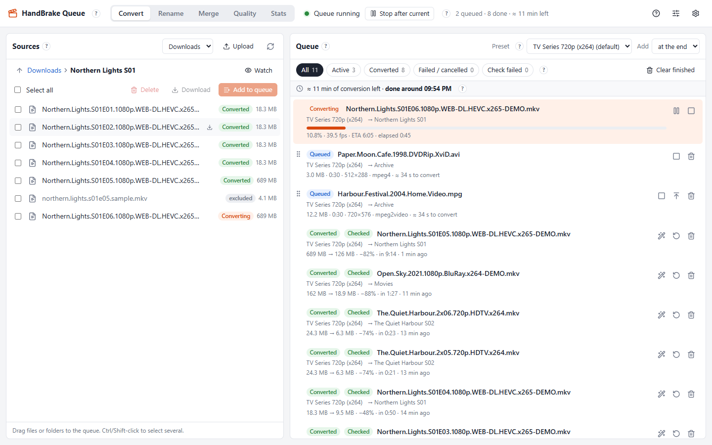

> **Not affiliated with HandBrake.** HandBrake is a separate project by the
> HandBrake Team. This app only runs its command-line tool. See
> [Credits and licences](#credits-and-licences).

## Contents

**What it is**

- [Features](#features): converting, files, subtitles, tools and everything else
- [Screenshots](#screenshots)

**Getting started**

- [Requirements](#requirements)
- [Hardware and performance](#hardware-and-performance): what to expect from a mini PC or a Raspberry Pi
- [Installation](#installation)
  - [1. Docker on Linux](#1-docker-on-linux)
  - [2. Docker Desktop on Windows or macOS](#2-docker-desktop-on-windows-or-macos)
  - [3. Linux without Docker](#3-linux-without-docker)
  - [4. Windows without Docker](#4-windows-without-docker)
- [First steps](#first-steps)
- [Configuration](#configuration)
  - [Docker (`.env`)](#docker-env)
  - [Without Docker (environment variables)](#without-docker-environment-variables)
- [Updating](#updating)

**Running it**

- [Hardware encoding (Intel Quick Sync)](#hardware-encoding-intel-quick-sync)
- [Security](#security)
- [Troubleshooting](#troubleshooting)

**The project**

- [Development](#development)
  - [Releasing (maintainers)](#releasing-maintainers)
- [Credits and licences](#credits-and-licences)
- [Disclaimer](#disclaimer)

## Features

**Converting**

- **Preset editor, like the desktop app.** Make a preset from one of
  HandBrake's built-in presets (e.g. Fast 1080p30) or from one of yours, and
  change it in the same tabs as HandBrake: Summary, Dimensions, Filters, Video,
  Audio and Subtitles, plus the raw JSON. The encoders and their
  preset/tune/profile/level lists come from the server's HandBrakeCLI, so only
  what it can run is offered; combinations HandBrake would refuse (e.g. H.265
  in WebM) are flagged before saving. **Save as new** keeps the original.
- **Presets from the desktop app.** In HandBrake, use Presets → Export, then
  import the `.json` on the **Presets** page. Files with several presets or
  folders are supported. The page shows every setting of a preset, grouped like
  HandBrake's tabs, plus its raw JSON, how it has performed (speed, size
  reduction) and a download that HandBrake can import again. Two ready-made
  presets are in [`presets/`](presets).
- **Drag and drop.** Drag files or whole folders from the source browser into
  the queue. Folders add every video inside, recursively, skipping files that
  are already converted or match an exclude word such as `sample`.
- **Queue management:** live progress, fps and ETA; pause/resume and cancel;
  reorder by dragging; retry, or "convert again" with another preset; per-job
  details with source tracks, sizes, compression, encode time and the full
  HandBrake log.
- **Manual start.** Adding files never starts converting; press **Start**. The
  queue stops by itself when the last job is done. The conversion window and
  watch folders can start it for you, both opt-in.
- **Finish time.** The queue shows how much conversion time is left and when it
  will be done, and each queued job shows its own estimate (source length ×
  the median speed of the last 20 conversions with the same preset).
- **Conversion window:** convert only between set times on chosen days, e.g.
  23:00–07:00. A job that is converting when the window closes is finished.
- **Watch folders:** new videos in chosen folders are added to the queue by
  themselves, each folder with its own preset, once they have stopped changing.
  Polling, so it works on NFS/SMB shares.
- **Safe output.** Each encode is written to `name.mkv.part` and renamed when it
  finishes, so media servers never pick up half-written files. Existing files
  are never overwritten: the new file gets a suffix, `name (1).mkv`.
- **Check after conversion** (Full, Quick or Off): each output must be readable,
  as long as the source, and have every audio and subtitle track HandBrake
  wrote. **Full** also decodes every frame. Results show as **Checked**,
  **Check warnings** or **Check failed**.
- **Subtitle files next to the videos** (`Movie.en.srt`, `Movie.it.forced.srt`,
  a `Subs` folder; SRT, ASS/SSA, WebVTT, VobSub `.idx`/`.sub`, PGS `.sup`) are
  found by themselves. By default the ones in languages the video doesn't
  have are embedded, and every one is copied next to the converted file,
  named the way Plex, Jellyfin and Emby expect (`Movie.en.srt`). The choice
  can be changed in Settings, for the whole queue or for a single job. An
  editor shifts the timing, fixes the frame rate and the character set, and
  removes hearing-impaired text, formatting and adverts; the original files
  are never changed. Copies follow the video when it is renamed.
- **Survives restarts.** An interrupted job goes back to the queue (HandBrake
  cannot resume an encode from the middle, so it starts again from 0%).

**Files**

- **Server-local folders.** Browse one or more *sources* folders (local disk,
  NFS or SMB mounts…); results go to a *target* folder. Folders can have a
  friendly name ("Downloads") shown instead of the path.
- **Upload from your computer** in 32 MB chunks with automatic retries. An
  interrupted upload continues where it stopped.
- **Download to your computer:** single files with resume support, or folders
  and several files as one ZIP built on the fly (ZIP64 for files over 4 GB).
- **Output layout:** `target/<source folder>/file`, the full source path
  mirrored, or everything flat in the target folder.
- **Delete sources** only when you ask: **Delete** shows exactly what will go
  and asks first. Files in the queue, the target folder and folders marked
  **Protect** (e.g. one a download client seeds from) are refused.

**Tools**

- **Quality check:** reads every video in chosen folders with ffprobe and lists
  files with an old container or codec (AVI, DivX/Xvid, MPEG-2, WMV…), a low
  resolution or a low bitrate. Flagged files can be queued or exported as CSV.
- **Merge:** joins converted files into one MKV with mkvmerge, without
  re-encoding. Chapters of each part are kept and moved to where the part
  starts. The merged file is checked like a conversion.
- **Rename:** recognises TV episodes (`S01E02`, `1x02`) and movies (title +
  year), drops release tags (`1080p`, `WEB-DL`, `x265`…) and builds clean names
  from templates (`Show S01e02 - Episode title`, `Movie Title (2020)`). Preview
  and edit before applying, undo any batch, and optionally rename after each
  conversion. Rule sets work like Advanced Renamer methods and can import
  Advanced Renamer `.aren` presets.
- **Naming check:** compares every video in chosen folders of the target
  folder with the name a rename rule set would give it, and lists the files
  with a different name or that the rules can't fully recognise. Only names are
  read, so a whole library takes seconds; **Fix in Rename** opens the chosen
  files in Rename with the same rules. The last 20 results are kept, and files
  renamed since a check are marked as such.
- **Stats:** files converted, space saved, encode time and speed, per day or
  month, per preset, and the biggest savings.

**Everything else**

- **Notifications:** a webhook (JSON POST, e.g. n8n or Home Assistant) and/or
  e-mail over SMTP when the queue finishes, a conversion or check fails, a file
  is converted or a watch folder adds files. In the browser, the tab title
  shows progress and desktop notifications can be turned on.
- **Backup and restore:** a ZIP with the database (settings, presets, rename
  rules, jobs, histories) and optionally the logs; never video files.
  Downloadable, saved on the server, or scheduled. Restore runs live.
- **Settings page** with a save bar listing unsaved sections, and an **About**
  section with version, release notes, credits and licence.
- **In-app help:** a round **?** next to every page, panel and setting, plus a
  **Help** search in the top bar.
- **Works on a phone:** compact top bar, one panel at a time, and buttons for
  everything that needs drag and drop on a computer.
- **Light and dark theme**, following your system setting.
- **Five languages:** the app and its help in English, Italian, German, French
  or Spanish, chosen in Settings → Language, or each browser's own language.

## Screenshots

All files shown are generated demo videos.

<table>
  <tr>
    <td width="50%"><a href="docs/screenshots/job-details.png">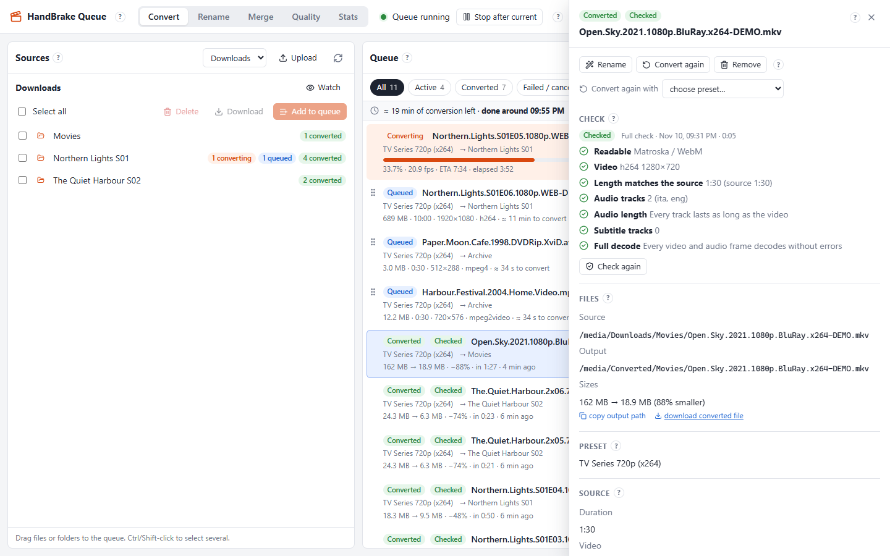</a><br><b>Job details</b>: the check after conversion, sizes, tracks and the HandBrake log</td>
    <td width="50%"><a href="docs/screenshots/presets.png">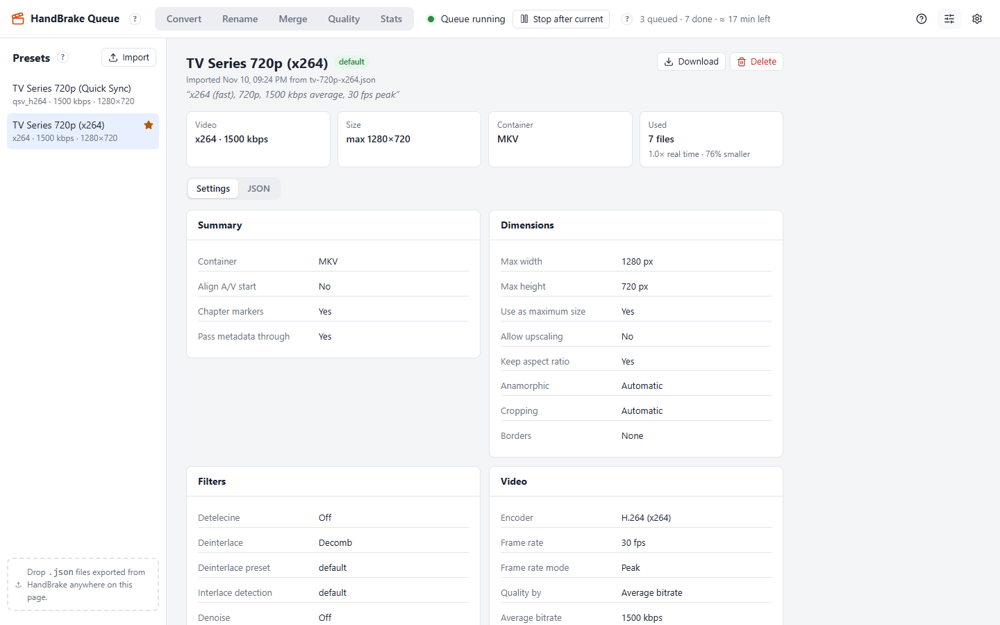</a><br><b>Presets</b> made in the editor or imported from the desktop app, with every setting and how they performed</td>
  </tr>
  <tr>
    <td><a href="docs/screenshots/quality.png">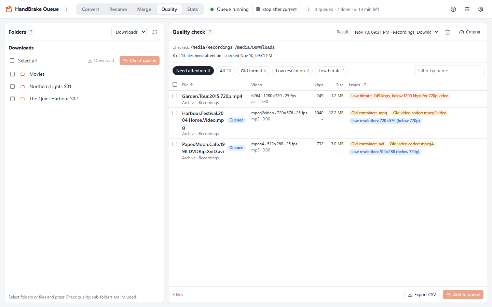</a><br><b>Quality check</b>: old formats, low resolution and low bitrate at a glance</td>
    <td><a href="docs/screenshots/rename.png">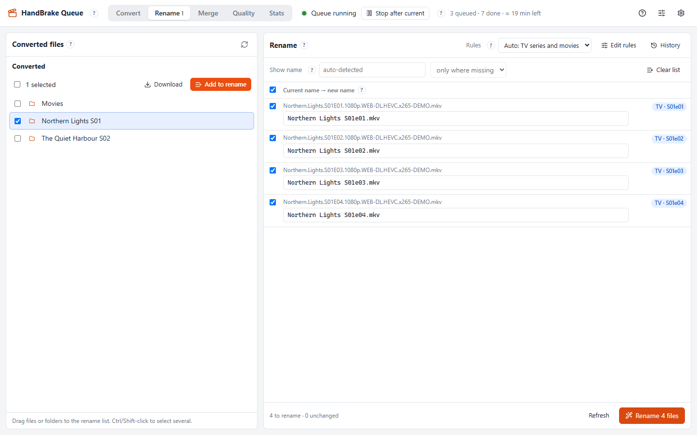</a><br><b>Rename</b>: clean names for episodes and movies, previewed before applying</td>
  </tr>
  <tr>
    <td><a href="docs/screenshots/merge.png">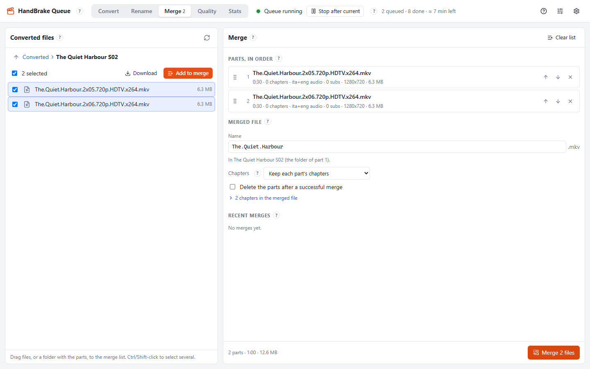</a><br><b>Merge</b> converted parts into one MKV, chapters included</td>
    <td><a href="docs/screenshots/stats.png">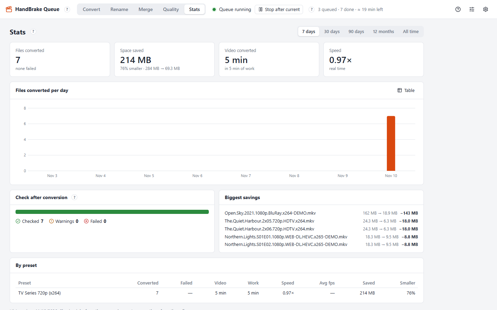</a><br><b>Stats</b>: space saved, speed, check results and per-preset numbers</td>
  </tr>
  <tr>
    <td><a href="docs/screenshots/settings.png">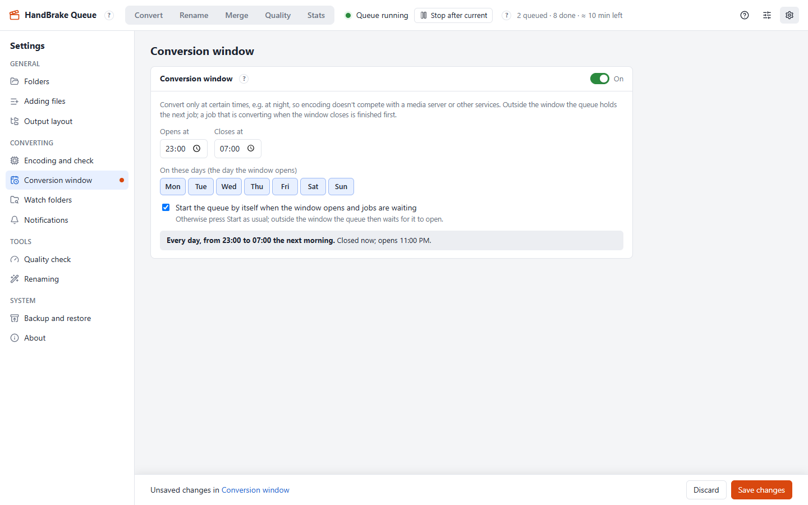</a><br><b>Settings</b>, here the conversion window (overnight encoding)</td>
    <td><a href="docs/screenshots/convert-dark.png">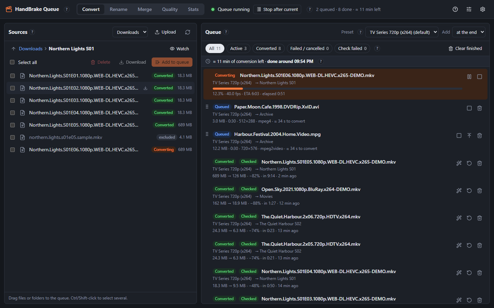</a><br><b>Dark theme</b></td>
  </tr>
</table>

<p>
  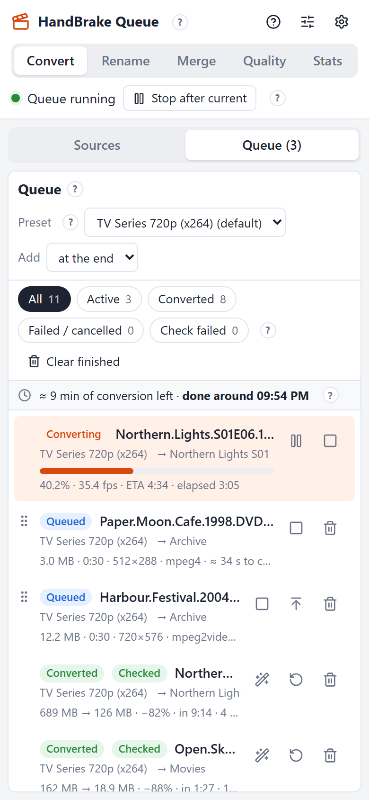
  &nbsp;
  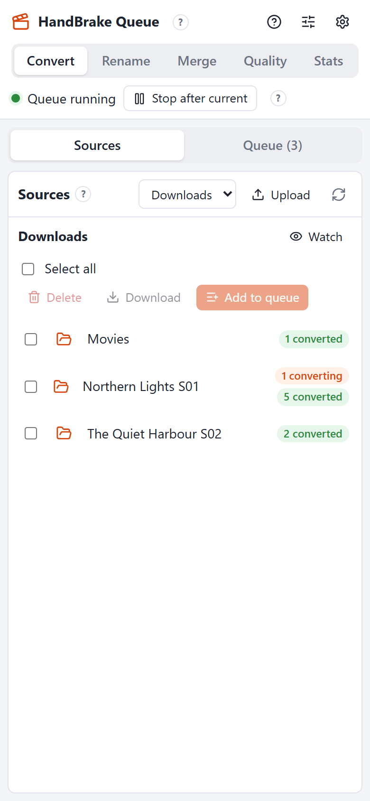
</p>

## Requirements

| | Docker (recommended) | Without Docker |
|---|---|---|
| **OS** | Linux (amd64 or arm64). Windows 10/11 or macOS with Docker Desktop | Linux, Windows 10/11 (macOS should work but is untested) |
| **Software** | Docker Engine with Compose v2.24 or newer, git | Node.js 22.13 or newer (24 LTS recommended), git, HandBrakeCLI, FFmpeg (`ffmpeg` + `ffprobe`), MKVToolNix (`mkvmerge`) |
| **CPU / RAM** | Any x86-64 or ARM64 CPU; 2 GB RAM (see [Hardware and performance](#hardware-and-performance)). The first build compiles HandBrake: allow 4 GB RAM, ~10 GB free disk and 45–60 minutes on a 4-thread CPU | Any 64-bit CPU; 2 GB RAM. Encoding speed depends on the CPU |
| **GPU (optional)** | Intel iGPU, 6th gen or newer, for Quick Sync (Linux hosts only) | CPU encoding; Quick Sync needs a HandBrakeCLI built with QSV |
| **Browser** | Any recent Chrome, Edge, Firefox or Safari, desktop or mobile | same |

FFmpeg is only needed for the check after conversion and the quality check,
and MKVToolNix only for merging. The rest of the app works without them. The
Docker image includes all of them.

## Hardware and performance

EncForge itself is light (a Node.js server using ~100 MB of RAM). The
conversion speed depends on the CPU, or on the GPU with Intel Quick Sync.

**What you need:**

- **CPU:** any 64-bit x86 or ARM CPU. With 4 threads or more, x264 converts a
  1080p episode to 720p in about real time. On slower CPUs the queue still works,
  but it is better to leave it running overnight.
- **RAM:** 2 GB. One 1080p → 720p x264 conversion uses about 1.1 GB, and the
  app runs one conversion at a time.
- **GPU (optional):** an Intel iGPU, 6th generation or newer, for Quick Sync
  (Docker on Linux). At the same bitrate it is about 2–3× faster than x264 on
  the same machine.
- **Disk and network:** sources and targets can be on a local disk or a NAS
  (NFS or SMB mount). A 1080p source is read at only a few MB/s, so a
  1 Gbit/s network is more than enough.

**Measured speeds.** These use the same test: a 2-minute clip of a 1080p
HEVC 10-bit TV episode (23.976 fps, two AAC audio tracks), converted to 720p
at 1500 kbps with the presets in [`presets/`](presets/), using HandBrake 1.11.2.
The episode column is the time for a 43-minute episode. The check after
conversion adds a little time on top.

| Machine | CPU / GPU | RAM | Encoder | Speed | × real time | 43-min episode |
|---|---|---|---|---|---|---|
| Raspberry Pi 5 | Cortex-A76, 4 cores | 8 GB | x264 | 21.6 fps¹ | 0.9× | ~48 min |
| ASUS Chromebox 4, repurposed: ChromeOS replaced by a Linux distro (Ubuntu 26.04)² | Core i3-10110U, 2 cores / 4 threads | 8 GB | x264 | 29 fps | 1.2× | ~36 min |
| ASUS Chromebox 4, same | Intel UHD 620 (Quick Sync) | 8 GB | qsv_h264 | 62 fps | 2.6× | ~17 min |
| Laptop, Windows 11 + Docker Desktop | Core i7-1355U, 10 cores / 12 threads | 64 GB | x264 | 76 fps | 3.2× | ~14 min |

¹ Measured on a clip from a different 1080p episode with the same x264
preset, so read it as ±10%. The Raspberry Pi 5 has no hardware H.264 encoder,
so x264 is the only option there.

² A Chromebox does not run EncForge as sold: ChromeOS has to be
replaced by a regular Linux distribution, which on these machines usually
means installing UEFI firmware first. With that done it is a small, quiet and
low-power home server with an Intel iGPU for Quick Sync.

**In real use:** the repurposed Chromebox 4 above runs EncForge with the
Quick Sync preset. Its first 139 TV episodes (about 60 hours of 1080p HEVC
video, read from a NAS over NFS) took 17.7 hours in total, an average of
3.4× real time, or about 13 minutes per 43-minute episode. Quality was
checked after each conversion.

Your numbers will differ with the source (resolution, codec, 10-bit), the
preset (encoder speed, filters such as decomb or denoise) and the cooling. The
**Stats** view shows the average speed of your own conversions.

## Installation

Pick one:

1. [Docker on Linux](#1-docker-on-linux): recommended; includes Intel Quick Sync.
2. [Docker Desktop on Windows or macOS](#2-docker-desktop-on-windows-or-macos)
3. [Linux without Docker](#3-linux-without-docker)
4. [Windows without Docker](#4-windows-without-docker)

### 1. Docker on Linux

**Install the prerequisites** (Debian/Ubuntu shown; other distributions: see
[Docker's install guide](https://docs.docker.com/engine/install/)):

```bash
sudo apt update && sudo apt install -y git curl
curl -fsSL https://get.docker.com | sudo sh     # Docker Engine + Compose plugin
sudo usermod -aG docker "$USER"                 # then log out and in again
docker compose version                          # must be v2.24 or newer
```

**Get the app and configure it:**

```bash
git clone https://github.com/dassige/encforge.git encforge
cd encforge
cp .env.example .env
nano .env
```

In `.env`, set at least:

- `PUID` / `PGID`: the owner of your media files (`id -u`, `id -g`).
  Converted files are written as this user.
- `MEDIA_DIR`: the host folder that holds your videos (e.g. `/mnt` or
  `/srv/media`). It appears at the same path inside the container.
- `SOURCE_ROOT` / `TARGET_ROOT`: where videos come from and where converted
  files go, both inside `MEDIA_DIR`. You can change them (and add more source
  folders) in the UI later.
- `TZ`: your time zone, e.g. `Europe/London`.
- **Intel GPU:** set `RENDER_GID` to `getent group render | cut -d: -f3`.
  **No Intel GPU** (`ls /dev/dri` shows nothing): uncomment the Linux
  `COMPOSE_FILE=` line instead.

All settings are explained in [Configuration](#configuration).

**Build and start:**

```bash
docker compose up -d --build
docker compose logs -f        # Ctrl+C to stop following the log
```

The first build compiles HandBrake from source, which takes 45–60 minutes on
a 4-thread CPU. Later builds reuse it and take a minute or two. When the log
shows `Server listening`, open `http://<server-ip>:8095` and go to
[First steps](#first-steps).

The container restarts by itself after a reboot. The database, logs and
backups are in `./data`.

### 2. Docker Desktop on Windows or macOS

1. Install [Docker Desktop](https://www.docker.com/products/docker-desktop/)
   and [Git](https://git-scm.com/downloads), or with winget on Windows:
   `winget install Docker.DockerDesktop Git.Git`. Start Docker Desktop once.
2. In PowerShell (Windows) or Terminal (macOS):

   ```powershell
   git clone https://github.com/dassige/encforge.git encforge
   cd encforge
   copy .env.example .env        # macOS: cp .env.example .env
   notepad .env                  # macOS: open -e .env
   ```

3. In `.env`:
   - Quick Sync is not available under Docker Desktop. Uncomment the
     `COMPOSE_FILE=` line for your system. Windows uses `;` between the files,
     macOS uses `:`.
   - **Windows:** a Windows path can't be used inside the Linux container, so
     mount your video folder at a Linux path:

     ```ini
     MEDIA_DIR=D:/Videos
     MEDIA_MOUNT=/media
     SOURCE_ROOT=/media/downloads
     TARGET_ROOT=/media/converted
     ```

     In the app, folders then look like `/media/...`.
   - **macOS:** set `MEDIA_DIR` to your folder, e.g. `/Users/you/Movies`, and
     `SOURCE_ROOT` / `TARGET_ROOT` to folders inside it. No `MEDIA_MOUNT`
     needed.
   - `PUID`, `PGID`, `MEDIA_GID` and `RENDER_GID` can stay as they are.
4. Build and start: `docker compose up -d --build` (the first build takes
   45–60 minutes; give Docker Desktop at least 4 GB of memory in its settings).
   Then open `http://localhost:8095`.

### 3. Linux without Docker

No container, but no Quick Sync either with distribution packages (see
[Hardware encoding](#hardware-encoding-intel-quick-sync)).

**Install the prerequisites** (Debian/Ubuntu):

```bash
sudo apt update
sudo apt install -y git handbrake-cli ffmpeg mkvtoolnix nodejs npm
node --version            # must be v22.13 or newer
```

If your distribution's Node.js is older, install a current one from
[nodejs.org](https://nodejs.org/en/download) (e.g. via NodeSource or `nvm`).
On Fedora: `sudo dnf install git HandBrake-cli ffmpeg mkvtoolnix nodejs` (FFmpeg
and HandBrake come from RPM Fusion).

**Build the app:**

```bash
sudo git clone https://github.com/dassige/encforge.git /opt/encforge
sudo chown -R "$USER" /opt/encforge
cd /opt/encforge
(cd web && npm ci && npm run build)
(cd server && npm ci --omit=dev)
```

**Try it** (Ctrl+C to stop):

```bash
cd /opt/encforge/server
DATA_DIR=$HOME/.encforge SOURCE_ROOT=/srv/media/downloads TARGET_ROOT=/srv/media/converted npm start
```

Open `http://<server-ip>:8095`.

**Run it as a service.** Create `/etc/systemd/system/encforge.service`,
with `User=` set to the owner of your media files:

```ini
[Unit]
Description=EncForge
After=network-online.target remote-fs.target
Wants=network-online.target

[Service]
User=media
WorkingDirectory=/opt/encforge/server
StateDirectory=encforge
Environment=DATA_DIR=/var/lib/encforge
Environment=PORT=8095
Environment=SOURCE_ROOT=/srv/media/downloads
Environment=TARGET_ROOT=/srv/media/converted
ExecStart=/usr/bin/node --disable-warning=ExperimentalWarning src/index.js
KillSignal=SIGTERM
TimeoutStopSec=20
Restart=on-failure

[Install]
WantedBy=multi-user.target
```

```bash
sudo systemctl daemon-reload
sudo systemctl enable --now encforge
journalctl -u encforge -f
```

Use the path from `which node` in `ExecStart` if Node.js is not in `/usr/bin`.

### 4. Windows without Docker

Runs directly on Windows with the official Windows builds of the tools.
Differences from Linux: running conversions can't be **paused** (only
cancelled), and the CPU priority setting is ignored.

**Install the prerequisites** in PowerShell:

```powershell
winget install OpenJS.NodeJS.LTS Git.Git Gyan.FFmpeg MoritzBunkus.MKVToolNix
```

Then download **HandBrakeCLI** (the command-line version, not the desktop
app) from [handbrake.fr/downloads2.php](https://handbrake.fr/downloads2.php)
and unzip it, e.g. to `C:\Tools\HandBrakeCLI\`. Close and reopen PowerShell so
the new programs are on the `PATH`, then check:

```powershell
node --version       # v22.13 or newer
ffprobe -version
& "C:\Tools\HandBrakeCLI\HandBrakeCLI.exe" --version
```

**Build the app:**

```powershell
git clone https://github.com/dassige/encforge.git C:\encforge
cd C:\encforge\web
npm ci; npm run build
cd ..\server
npm ci --omit=dev
```

**Start it:**

```powershell
cd C:\encforge\server
$env:DATA_DIR      = "C:\encforge\data"
$env:SOURCE_ROOT   = "D:\Videos\Downloads"
$env:TARGET_ROOT   = "D:\Videos\Converted"
$env:HANDBRAKE_CLI = "C:\Tools\HandBrakeCLI\HandBrakeCLI.exe"
$env:MKVMERGE      = "C:\Program Files\MKVToolNix\mkvmerge.exe"
npm start
```

Open `http://localhost:8095`. Allow Node.js through Windows Firewall when
asked if other devices should reach it.

**Start it with Windows:** run it as a service with
[NSSM](https://nssm.cc/), for example:

```powershell
nssm install EncForge "C:\Program Files\nodejs\node.exe" "--disable-warning=ExperimentalWarning src\index.js"
nssm set EncForge AppDirectory C:\encforge\server
nssm set EncForge AppEnvironmentExtra DATA_DIR=C:\encforge\data HANDBRAKE_CLI=C:\Tools\HandBrakeCLI\HandBrakeCLI.exe "MKVMERGE=C:\Program Files\MKVToolNix\mkvmerge.exe"
nssm set EncForge ObjectName .\YourUser YourPassword
nssm start EncForge
```

Run the service as your own user (`ObjectName`), not the default system
account: that account can't see mapped drives or your network shares. Use UNC
paths (`\\nas\videos`) for network folders.

## First steps

1. **Make or import a preset.** Open **Presets** and press **New** to start
   from one of HandBrake's built-in presets, then adjust it in the editor. Or,
   in the HandBrake desktop app, use Presets → Export to save a preset as
   `.json` (or take one from [`presets/`](presets)) and **Import** it.
2. **Check the folders.** In **Settings → Folders**, check the sources and
   target folders, add more sources folders and give them friendly names.
3. **Queue and convert.** On **Convert**, drag files or folders from the
   Sources panel into the queue (or select them and use **Add to queue**), then
   press **Start**.

Every page and setting has a **?** with help.

## Configuration

### Docker (`.env`)

| Variable | Default | Meaning |
|---|---|---|
| `PUID` / `PGID` | `1000` | User and group the container runs as; converted files are owned by them |
| `MEDIA_GID` | `100` | Extra group, for shares that grant access by group. Synology NFS uses `users` (100). Symptom when missing: "permission denied" on a folder the host user can open |
| `RENDER_GID` | `991` | Group of `/dev/dri/renderD128` on the host, for Intel Quick Sync |
| `COMPOSE_FILE` | – | Add `docker-compose.no-gpu.yml` on hosts without `/dev/dri` (see `.env.example`) |
| `PORT` | `8095` | Web UI port on the host |
| `MEDIA_DIR` | `/mnt` | Host folder with your videos, bind-mounted into the container |
| `MEDIA_MOUNT` | `MEDIA_DIR` | Where `MEDIA_DIR` appears inside the container. Set it on Windows (e.g. `/media`) |
| `SOURCE_ROOT` / `TARGET_ROOT` | `/mnt/downloads`, `/mnt/converted` | Initial folders, as seen inside the container. Used on first start only; change them later in Settings |
| `TZ` | `UTC` | Time zone of the server clock. The conversion window follows it |

### Without Docker (environment variables)

| Variable | Default | Meaning |
|---|---|---|
| `PORT` | `8095` | Web UI port |
| `HOST` | `0.0.0.0` | Address to listen on. `127.0.0.1` makes it reachable from this computer only |
| `DATA_DIR` | `./data` | Database, logs and backups |
| `SOURCE_ROOT` / `TARGET_ROOT` | `/mnt/downloads`, `/mnt/converted` | Initial folders, used on first start only |
| `HANDBRAKE_CLI` | `HandBrakeCLI` | HandBrakeCLI program (name on the `PATH`, or full path) |
| `FFPROBE` / `FFMPEG` | `ffprobe` / `ffmpeg` | FFmpeg programs |
| `MKVMERGE` | `mkvmerge` | MKVToolNix merge program |
| `WEB_DIR` | `../web/dist` | Built web UI |
| `LOG_LEVEL` | `info` | `debug`, `info`, `warn` or `error` |

Everything else (folders, output layout, check mode, CPU priority, conversion
window, watch folders, notifications, backups…) is set in the app, on the
**Settings** page.

## Updating

**Docker, on the server**, in the folder you cloned:

```bash
scripts/deploy.sh --here
```

It refuses to run while a job is converting, because restarting the container
would start that encode again from 0% (`FORCE=1` overrides). Then it gets the
latest version from GitHub, rebuilds and restarts. `.env` and `data/` are kept.
To do the same by hand:

```bash
git pull
docker compose up -d --build --remove-orphans
```

**Docker, from another computer** (Linux, macOS, or Git Bash on Windows), over
SSH. The server pulls from GitHub itself, so only what is on GitHub is deployed:

```bash
scripts/deploy.sh user@server [folder]      # folder default: ~/encforge
```

The first run clones the repository on the server. Defaults for the host,
folder and SSH options can go in a git-ignored `.deploy.env`: copy
[`.deploy.env.example`](.deploy.env.example) and adjust it.

**Without Docker:**

```bash
git pull
(cd web && npm ci && npm run build)
(cd server && npm ci --omit=dev)
sudo systemctl restart encforge     # or restart the Windows service / npm start
```

Back up first if you want to be able to go back: **Settings → Backup and
restore**.

### Updating an install from before the rename

EncForge used to be called Handbrake-UI ("HandBrake Queue" in the app). An
install made under the old name updates like any other, and keeps its data:

- The database `data/handbrake-ui.db` is renamed to `encforge.db` on the first
  start. Backups and exported rename rules made under the old name still
  restore and import.
- Docker: the container is now called `encforge`. `scripts/deploy.sh` removes
  the old `handbrake-ui` container and image; by hand, add `--remove-orphans`
  as above, or the old container keeps the port.
- Your install folder, `.env` and `data/` stay where they are; there is no need
  to move them. Existing Linux services (`handbrake-ui.service`) and Windows
  services (`HandBrakeQueue`) keep working under their old names.
- `git pull` keeps working, because GitHub redirects the old address. To point
  the checkout at the new one:
  `git remote set-url origin https://github.com/dassige/encforge.git`

## Hardware encoding (Intel Quick Sync)

The Docker image builds `HandBrakeCLI` from the upstream source (version set by
`HANDBRAKE_VERSION` in the `Dockerfile`), with Intel Quick Sync on amd64.
Ubuntu's own `handbrake-cli` package can't be used for Quick Sync: it links the
system FFmpeg, which lacks HandBrake's QSV patches, so every `qsv_*` encode
fails in the muxer ("non monotonically increasing dts").

- The encoder always comes from your preset: a preset with `qsv_h264` /
  `qsv_h265` uses the GPU, `x264` / `x265` the CPU.
  [`presets/tv-720p-qsv.json`](presets/tv-720p-qsv.json) is the Quick Sync
  version of [`presets/tv-720p-x264.json`](presets/tv-720p-x264.json). On a
  10th-gen Core i3 it encodes about 2.2× faster at the same bitrate, with
  slightly lower quality (SSIM 0.985 vs 0.988).
- `/dev/dri` must be passed through (the default `docker-compose.yml` does) and
  `RENDER_GID` must match the host's `render` group.
- Both Intel runtimes are included: the VPL GPU runtime for 11th gen (Tiger
  Lake) and newer, and the legacy Media SDK runtime for 6th–10th gen iGPUs.
  Quick Sync *decoding* (`--enable-qsv-decoding`) does not work with the legacy
  runtime on Linux, so leave it off in presets on those machines; decoding then
  runs on the CPU.
- NVIDIA (NVENC) and AMD (VCE) encoders are not built into the image.

## Security

The app has **no login**. Anyone who can open its web page can browse,
upload, download, rename and **delete files** in the configured folders, and
change its settings.

- Run it only on a trusted home or office network. **Do not expose port 8095
  to the internet.**
- For remote access, use a VPN (WireGuard, Tailscale…) or a reverse proxy with
  authentication and HTTPS in front of it.
- Give it only the folders it needs: `MEDIA_DIR` in Docker, and the sources and
  target folders in Settings. The app refuses paths outside the configured
  folders.
- The SMTP password is stored in its database and backups, so keep `data/` and
  backup files private.

## Troubleshooting

| Problem | Fix |
|---|---|
| "permission denied" on a folder the host user can open | The share grants access by group: set `MEDIA_GID` (Synology NFS: `100`). Check `PUID`/`PGID` |
| `docker compose up` fails with `/dev/dri: no such file or directory` | No Intel GPU: enable `docker-compose.no-gpu.yml` with `COMPOSE_FILE` in `.env` |
| `!reset` / `!override` error from Compose | Your Compose is older than v2.24: update Docker |
| Quick Sync preset fails or isn't listed | Check `ls -l /dev/dri` on the host and `RENDER_GID`. Settings → About lists the video encoders HandBrakeCLI found: `qsv_*` ones appear only when Quick Sync works |
| Red banner "HandBrakeCLI is not available" | Without Docker: install it, or set `HANDBRAKE_CLI` to its full path |
| Network share mounted after the container started doesn't show up | The bind mount uses `rslave` propagation, so mounts made later under `MEDIA_DIR` should appear. Otherwise `docker compose restart` |
| The conversion window starts at the wrong time | Set `TZ` (Docker) or the system time zone. Settings → Conversion window warns when it differs from your browser's |
| Logs | Docker: `docker compose logs -f`. Without Docker: the console, or `journalctl -u encforge -f`. Per-job HandBrake logs: job details in the app |

## Development

```bash
cd server && npm install && SOURCE_ROOT=/some/dir TARGET_ROOT=/other/dir npm run dev   # API on :8095
cd web && npm install && npm run dev                                                   # UI on :5173, proxies /api
cd server && npm test
```

**Stack:** Node.js + Fastify, the built-in `node:sqlite`, Server-Sent Events
for live updates; React + Vite for the UI. One process, no external database.

The in-app help lives in `web/src/help/help.json`. `server/test/help.test.js`
checks that every **?** has a topic and that every link works.

The UI text lives in `web/src/i18n/locales/<lang>/*.json` (`t('namespace.key')`
in the code; English is the source) and the translated help in
`web/src/help/help.<lang>.json`. `server/test/i18n.test.js` checks that every
key used in the code exists and that every language has every string and help
topic, with the same placeholders and links.

Issues and pull requests are welcome. Please run `npm test` in `server/` and
`npm run build` in `web/` before sending a pull request.

### Releasing (maintainers)

`npm run release` in the repo root runs `scripts/release.cjs`:

- It reads the version from the root `package.json` and refuses to run with
  uncommitted changes.
- It lists the commits since the previous `vX.Y.Z` tag and asks for
  confirmation.
- It creates and pushes the `vX.Y.Z` tag and creates the GitHub Release with
  `gh`. The notes are built from the conventional-commit messages (Features,
  Bug Fixes…), or are text you type.

The project values are in `scripts/release.config.cjs`. Settings → About links
to the GitHub release of the running version.

## Credits and licences

EncForge is © 2026 Gerry Dassi (DGSoft). It is free software: you can
redistribute it and/or modify it under the terms of the
[GNU General Public License, version 2](LICENSE) (GPL-2.0-only), as published
by the Free Software Foundation.

It was developed with [Claude Code](https://claude.com/claude-code),
Anthropic's AI coding assistant, which contributed to the code, tests and
documentation.

It runs or uses these projects, each under its own licence:

| Project | Used for | Licence |
|---|---|---|
| [HandBrake](https://handbrake.fr/) (HandBrakeCLI) | the video conversion engine; built from source, unmodified | GPL-2.0 |
| [FFmpeg](https://ffmpeg.org/) (ffprobe, ffmpeg) | reading video details, the check after conversion and the quality check | LGPL-2.1 / GPL-2.0 |
| [MKVToolNix](https://mkvtoolnix.download/) (mkvmerge) | merging converted files and their chapters | GPL-2.0 |
| [Intel VPL GPU runtime, Media SDK and media driver](https://github.com/intel/vpl-gpu-rt) | Quick Sync hardware encoding | MIT |
| [Node.js](https://nodejs.org/) | the server runtime, with its built-in SQLite | MIT |
| [SQLite](https://sqlite.org/) | the database | Public domain |
| [Fastify](https://fastify.dev/) | the web server | MIT |
| [Nodemailer](https://nodemailer.com/) | e-mail notifications | MIT-0 |
| [React](https://react.dev/) | the user interface | MIT |
| [Vite](https://vite.dev/) | building the user interface | MIT |
| [Lucide](https://lucide.dev/) | icons | ISC |
| [Advanced Renamer](https://www.advancedrenamer.com/) by Kim Jensen | the rename methods and the `.aren` presets the Rename view imports (not included) | Freeware |

The same list is in the app (Settings → About, from
`web/src/settings/credits.json`).

HandBrakeCLI, FFmpeg and MKVToolNix are separate programs: the app starts them
as external processes and does not link to them. The Docker image you build
*contains* them, so if you **redistribute that image** (e.g. push it to a
public registry), you must follow the GPL/LGPL for everything in it, including
offering the source code: this repository for EncForge, and the
upstream sources for the rest. The `Dockerfile` builds HandBrake from its
official, unmodified source tag.

If you distribute a modified version of EncForge, the GPL requires you
to publish your changes under the same licence.

## Disclaimer

This software is provided "as is", without warranty of any kind (see sections
11 and 12 of the [LICENSE](LICENSE)). It writes, renames and, when you ask, deletes files: keep
backups of media you care about, and try new settings on copies first.

HandBrake is a trademark of its respective owners. This project is not
affiliated with or endorsed by the HandBrake Team, the FFmpeg project,
MKVToolNix, Intel or Advanced Renamer.
